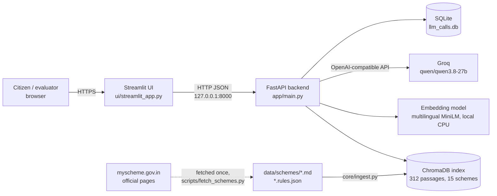
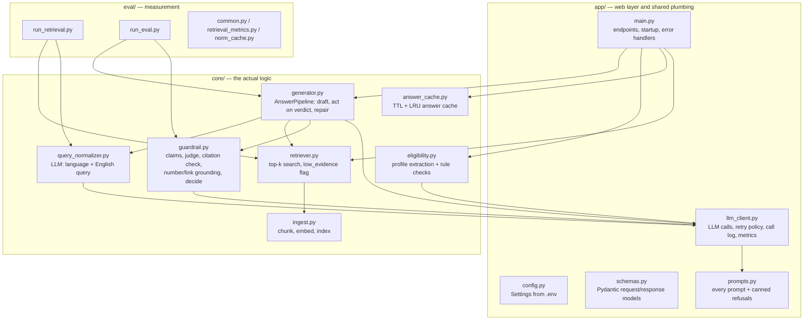
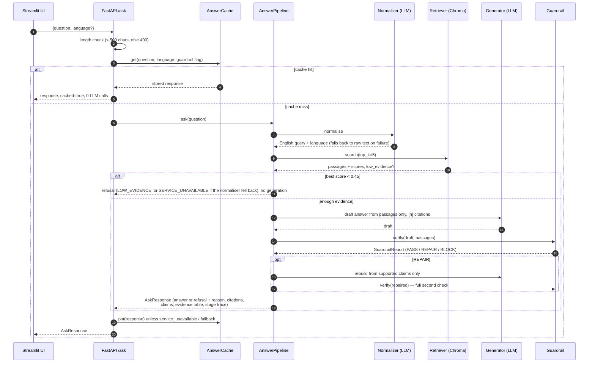
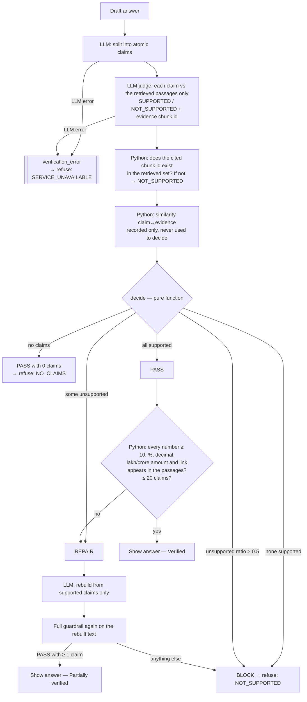
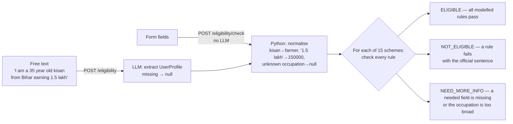
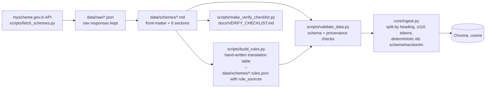
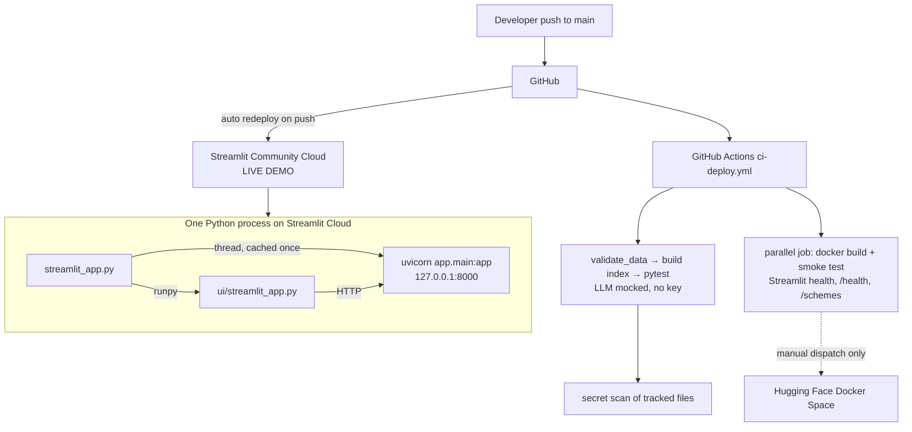

# SchemeSure architecture

This document describes the system **as implemented** on the `midterm-improvements`
branch (November 2026). Planned components are marked *planned* and drawn with dashed
lines; nothing here describes behaviour that the code does not have.

Contents:

1. [System context](#1-system-context)
2. [Module map](#2-module-map)
3. [Request flow: `POST /ask`](#3-request-flow-post-ask)
4. [The guardrail decision](#4-the-guardrail-decision)
5. [Eligibility flow](#5-eligibility-flow)
6. [Data pipeline](#6-data-pipeline)
7. [Deployment and CI](#7-deployment-and-ci)
8. [Extension points](#8-extension-points)
9. [Design invariants](#9-design-invariants)

---

## 1. System context

The UI holds **no business logic**. It renders what the API returns. Every decision
about what the user sees is made in Python on the backend.

## 2. Module map

| File | One-line job | LLM? |
|---|---|---|
| `app/main.py` | Endpoints; loads the model and index once at startup; maps errors to 400/404/502/503 | no |
| `app/llm_client.py` | The only place that talks to the LLM: retries, error classification, per-request deadline, SQLite log | calls it |
| `app/prompts.py` | All prompt text and the canned refusal messages (en / hi / hinglish) | — |
| `core/query_normalizer.py` | Detect language, rewrite the question as an English search query | 1 call |
| `core/retriever.py` | Cosine search in Chroma; `low_evidence` when best score < 0.45 | no |
| `core/generator.py` | `AnswerPipeline.ask`: orchestrates the whole request and decides what is shown | 1 call (+1 on repair) |
| `core/guardrail.py` | Split into claims, judge each claim, then Python checks and the decision | 2 calls (+2 on repair) |
| `core/eligibility.py` | Extract a profile (LLM) or accept a form (no LLM); apply rules in Python | 0–1 call |
| `core/answer_cache.py` | Serve a repeated question without new LLM calls (API layer only) | no |
| `ui/streamlit_app.py` | Five tabs: Ask, Eligibility, Schemes, How it works, System | no |
| `streamlit_app.py` | Streamlit Community Cloud entry point: starts the API in a thread, then runs the UI | no |

## 3. Request flow: `POST /ask`

LLM calls per question: **1** for a low-evidence refusal, **4** for a normal answer
(normalise, generate, split, judge), **7** when a repair happens (repair, split, judge
again). A cache hit costs **0**.

Every response carries a `trace` (stage, duration, LLM calls, outcome), so the UI's
**Pipeline** view shows what actually ran rather than a generic diagram.

## 4. The guardrail decision

What each layer is responsible for:

| Check | Done by | Can it be fooled? |
|---|---|---|
| Is there enough evidence to try? | Python threshold on retrieval score | Yes, by on-topic but unindexed questions (see eval results) |
| Is each claim supported? | LLM judge, sees only the passages | Yes; same model family as the generator. Human labels are planned (Roadmap P0-5) |
| Does the cited evidence exist? | Python | No — fabricated ids are rejected in code |
| Do numbers and links appear in the evidence? | Python regex + normalisation | Narrowly: numbers below 10 are not checked |
| Is the final decision consistent? | Python `decide()` (unit-tested) | No — it is a pure function |

Refusal reasons shown to the user are distinct: `low_evidence` ("no official
information"), `not_supported` (the draft failed verification), `no_claims` (the draft
asserted nothing checkable) and `service_unavailable` (the LLM failed; we do **not**
claim the information is missing).

## 5. Eligibility flow

The LLM never decides eligibility. It only fills a form. Conditions that are not
machine-checkable (e.g. "not an income-tax payer") are listed per scheme as
`unmodelled_conditions` so the user knows what to check themselves.

## 6. Data pipeline

Deterministic chunk ids mean re-running ingestion never duplicates passages, and the
evaluation can refer to a passage by id.

## 7. Deployment and CI

* **Live demo:** Streamlit Community Cloud runs the root `streamlit_app.py`, which
  starts FastAPI in a background thread and then runs the UI. Secrets are set in the
  Streamlit Cloud dashboard. The app sleeps when idle; the first visit after sleep
  rebuilds the index (cold start).
* **Container:** `Dockerfile` + `start.sh` build the index and download the model at
  build time and run the API and UI as two processes. CI builds and smoke-tests this image on every push to main and on every pull request to main. Deployment to a Hugging Face Space is manual
  (`scripts/deploy_hf.py`).

## 8. Extension points

These are the seams the second-half work plugs into (see `ROADMAP.md`):

| Planned work | Where it attaches | What changes |
|---|---|---|
| NLI verifier (*planned*) | `Guardrail(..., embed_fn=...)` already accepts an optional signal function; an `nli_fn` would sit beside it | A new per-claim field, recorded first; routing only after it is validated |
| Cross-model judge (*planned*) | `judge_claims(llm, ...)` takes the client as an argument | A second `LLMClient` with a different model |
| Larger corpus (*planned*) | `data/schemes/` + `validate_data.py` + `ingest.py` | More files; no code change for Markdown sources |
| Metadata pre-filter (*planned*) | `Retriever.search` | A `where={"scheme_id": ...}` filter in the Chroma query |
| Conditional eligibility rules (*planned*) | `check_scheme` | New rule types; unmodelled conditions move into checked rules |

## 9. Design invariants

These hold everywhere in the code and are covered by tests:

1. **The LLM never decides eligibility or the guardrail outcome.** Both are plain Python
   (`check_scheme`, `decide`).
2. **Fail closed.** If verification cannot run, the draft is withheld and the user is told
   the service failed. An unverified answer is never labelled verified.
3. **Refusals are honest about their cause.** A provider outage is never reported as
   "no official information".
4. **With the guardrail on, the citations shown are the passages that verified a claim**, never "everything retrieved". (With the guardrail off, the evaluation baseline, the answer's own [n] markers are used, or every retrieved passage if it has none.)
5. **Every LLM call is logged** (prompt name, model, tokens, latency, attempts, ok) to
   SQLite, and `/metrics` reads from that log.
6. **Secrets live only in `.env` / platform secrets.** Provider error text is logged
   server-side only and never returned to the browser.
